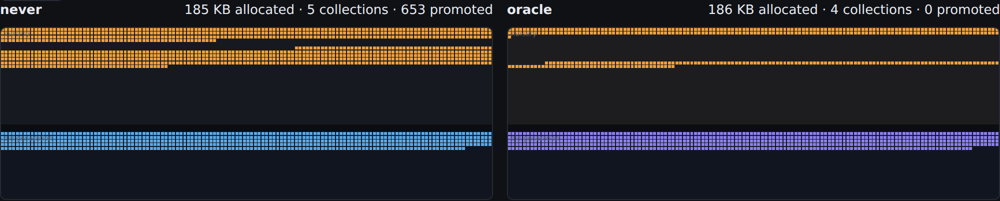
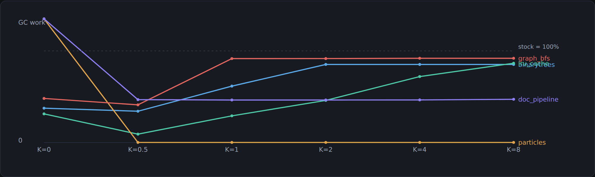

# halflife-gc

**A garbage collector that predicts how long an object will live — before it allocates it.**

Every generational collector on earth makes the same bet: *most objects die young*. It is
a good bet, and it is hardcoded. The allocator does not care whether it is handing out a
temporary from a hot inner loop or the root node of a cache that will outlive the process.
Both go in the nursery. Both get scanned. Whichever one survives gets copied out, byte by
byte, into the old generation.

That copy is pure waste for the second one. The collector *could* have put it in the old
generation to begin with — it just had no way to know.

So: what if it did? This repository builds a small language, a bytecode VM, four garbage
collectors, and a lifetime predictor that runs **inside the allocator**, on every single
allocation, and answers one question before the object exists:

> will this object still be alive when the nursery next fills up?

Then it measures what that is worth, against a collector that can see the future.

<p align="center">
  
</p>

<p align="center"><em>The same program, the same allocations, in the same order. Left: stock
generational — orange nursery, blue objects copied out of it. Right: same collector, but
objects predicted to survive are born in the old generation (purple). Same work done, 653
copies avoided. <a href="results/report.html">The full report animates this.</a></em></p>

---

## The headline

GC work relative to a stock generational collector, on a **held-out run** of each program —
different input size, different data from the one the predictor was trained on.
Lower is better.

| workload | mark-sweep | semispace | **generational** | gen+always | gen+sitetable | **gen+learned** | gen+oracle |
|---|---|---|---|---|---|---|---|
| `binarytrees`  | 27% | 78% | **100%** | 37% | 37% | **31%** | 34% |
| `lru_cache`    | 24% | 111% | **100%** | 31% | 31% | **31%** | 9% |
| `particles`    | 94% | 534% | **100%** | 230% | 16% | **0.02%** | 0.02% |
| `graph_bfs`    | 45% | 118% | **100%** | 48% | 94% | **94%** | 41% |
| `doc_pipeline` | 137% | 1701% | **100%** | 159% | 99% | **190%** | 46% |

`gen+oracle` reads true object lifetimes off a recorded trace. You cannot ship it. It is
here for one reason: without it, "the learned model saved 4%" is uninterpretable. With it,
you can say *how much of the available win was actually collected*:

| workload | headroom recovered by the learned model |
|---|---|
| `particles` | **100%** |
| `binarytrees` | **104%** |
| `lru_cache` | **76%** |
| `graph_bfs` | **11%** |
| `doc_pipeline` | **−168%** ← it made things worse |

Three wins, one shrug, and one clear loss. The loss is the most interesting row in the
table and it gets [its own section](#the-row-that-fails).

---

## What is actually in here

Nothing here is a wrapper around a library. The stack is built bottom-up so that every
allocation has a name the predictor can key on:

```
bench/*.mite                 five benchmark programs, written in Mite
        │
        ▼
halflife/mite/               lexer → recursive-descent parser → bytecode compiler
  lexer.py  parser.py          · assigns every allocation a stable *site id*
  compiler.py opcodes.py       · interns record shapes (hidden classes)
        │
        ▼
halflife/vm/                 stack VM + object model
  vm.py                        · tagged values packed into machine words
  heap.py                      · exact root scanning, pointer/non-pointer slots
        │
        ├──────────────► halflife/oracle/trace.py
        │                  runs the program under a collector that collects every
        │                  1 KB and writes down when each object died
        │                       │
        │                       ├── ground truth  ──►  the oracle collector (the ceiling)
        │                       └── training labels ─►  the model
        ▼                                                     │
halflife/gc/                 four collectors, one interface    │
  marksweep.py    non-moving, single space                     │
  semispace.py    Cheney copying                               │
  generational.py nursery + old gen + write barrier + remembered set
  predictors.py   ◄─────────────────────────────────────────────┘
                  never / always / per-site table / learned / perfect oracle
        │
        ▼
halflife/eval/run.py         the experiment: profile → train → sweep → score
halflife/viz/report.py       a self-contained HTML report with an animated heap
```

**The whole experiment lives in one method.** `Generational.choose_space()` decides where a
new object is born. Swap the predictor and nothing else changes — same VM, same write
barrier, same collection triggers, same everything. So any difference in the numbers is
attributable to prediction quality and nothing else.

### Mite

A small dynamically typed language exists because a real one would have been the wrong
tool. Instrumenting CPython means fighting an allocator you do not control and cannot
attribute; generating synthetic allocation traces means the allocation patterns are made
up. A small real language is the honest middle: real control flow, real data structures,
real aliasing — and a compiler that stamps every `record { … }` with an identity.

```
fun bottom_up(depth) {
  if (depth <= 0) { return record { l: nil, r: nil }; }
  return record { l: bottom_up(depth - 1), r: bottom_up(depth - 1) };
}
```

Functions, records with interned shapes, dynamic lists (header + backing array, so growth
allocates, like every real dynamic array), strings, integers, `while`/`if`/`break`, and six
builtins. Values are single machine words with three tag bits, so the *mutator* never
allocates outside the Mite heap — which matters, because otherwise CPython's own allocator
would be tangled up in the thing being measured.

```
$ python -m halflife dis bench/binarytrees.mite | head -9
fun @main/0  (locals=1)
     0  CONST              0
     1  STORE_GLOBAL       0
     2  CONST              1
     3  STORE_GLOBAL       1
     4  CONST              2
     5  LOAD_GLOBAL        1
     6  ADD                0
     7  CALL               1 1
```

### Measuring lifetimes

You cannot ask "how much could a perfect predictor win?" without knowing, for every object
the program ever allocated, exactly how long it stayed alive. `halflife/oracle/trace.py`
gets that by running the program under a collector with an absurdly small budget — it
collects every 1 KB of allocation — and recording, for each object, the first checkpoint at
which it was unreachable.

Lifetime is measured in **bytes allocated since birth**, not seconds and not collections,
because that unit is a property of the program alone: it does not move when you change the
heap size, the collector, or the machine.

```
$ python -m halflife sites bench/lru_cache.mite
site                                            objects  survive     bytes rate
@main:71 native(str)                               9000     4756    216000  52.8%
cache_put:50 record{key,val,next}                  5974     4747    191168  79.5%
@main:74 record{payload,key}                       5974     4747    143376  79.5%
make_cache:28 native(push)                            6        1      4128  16.7%
make_cache:25 list(n=0)                               2        1        72  50.0%
make_cache:31 record{buckets,size,cap,hits,mis        1        1        48 100.0%
...
```

That table is the whole project in miniature. The cache's entry nodes survive 79.5% of the
time and should mostly skip the nursery. The bucket array is allocated once and lives
forever. And one site — the `str()` on line 71 that builds a lookup key — is a coin flip at
52.8%, because the key is retained only when the lookup *missed*, which is decided **after**
the allocation. No amount of context makes that one predictable, and that is the point of
having it in the suite.

### The predictor

Feature-hashed logistic regression, ~120 lines, no dependencies, scored on every
allocation. Features are the allocation site, the enclosing function, the caller, the
object size, the call depth, how many objects that site has already produced, and
conjunctions of those.

Two constraints shaped it more than anything about accuracy:

1. **Mutator-visible state only.** Nursery occupancy and heap pressure are tempting
   features and are *forbidden*, because they differ between collector configurations. A
   model trained on the tracing run's heap state, then served under a different heap state,
   would degrade for reasons indistinguishable from the model simply being bad.
2. **Cheap.** It runs in the allocation fast path. Feature vectors repeat constantly — five
   programs, 43–138 distinct contexts each across tens of thousands of allocations — so
   predictions are memoised by feature vector, and the "model" becomes a dict lookup.

Hashing uses CRC32, not Python's `hash()`, which is randomised per process: a model trained
in one process would silently score garbage in the next. That is a genuinely nasty class of
bug and worth designing out rather than debugging.

---

## The mistake this project was built around

The first version of this experiment defined the oracle as "pretenure exactly the objects
that survive one nursery." It produced a result that made no sense: on two workloads the
*perfect* collector was beaten by the trivial policy of pretenuring everything.

The oracle was not broken. The target was wrong. An object that outlives the nursery by a
hair gets promoted and then dies immediately — pretenuring it does not save a copy, it
just moves the garbage somewhere that only a full trace can reclaim.

So pretenuring is not one policy, it is a **family** parameterised by one number:

> pretenure an object iff it will live for at least **K** nurseries

`K = 0` pretenures everything. `K = ∞` is the stock generational collector. Both are
members. The oracle now sweeps `K` and takes the best, which makes it a real upper bound on
what *any* lifetime-based pretenuring policy can do — and the learner's target becomes
"live at least `K*` nurseries", with `K*` chosen on the profiling run.

<p align="center"></p>

The curves say something you would not guess: the optimum sits at `K = 0.5` on four of five
workloads, and it is **sharp**. Being roughly right about *whether* an object is long-lived
is not enough; you have to be right about *how* long-lived.

---

## The row that fails

`doc_pipeline` builds documents, scores them, and keeps about one in six — and *which* one
is decided by a data-dependent branch taken after the allocation. It is the workload
designed to be hard, and the learned predictor does not merely fail to help. It makes the
collector **90% worse** than doing nothing.

The mechanism is visible in the numbers. On the held-out run the model has AUC 0.758 and
recall 0.707 — it finds most of the survivors — but precision **0.163**. It pretenures
866 KB, of which the great majority is garbage, straight into a generation that only a full
trace reclaims. Major collections go from 2 to 10.

Two things this is worth saying out loud:

**Offline model quality and collector outcome come apart.** The two errors do not cost the
same. A false negative costs one copy of one object. A false positive costs a full-heap
trace amortised over everything else in the old generation. Optimising AUC optimises the
wrong thing, and any real version of this would need a cost-weighted objective rather than
log loss.

**Threshold selection on a profiling run does not transfer here.** The learner picked
`K* = 4` and a decision threshold of 0.3 because those minimised GC work on the profiling
run, and both generalised badly to a run with 44% more documents and wider records. The
honest engineering fix is a guard rail: measure the pretenuring policy against no
pretenuring at run time and fall back when it is losing. That is not implemented — it is
[future work](#future-work), and it would be dishonest to report the good rows without this
one.

---

## Running it

No dependencies. Python 3.8+.

```bash
git clone https://github.com/<you>/halflife-gc && cd halflife-gc

python -m halflife run bench/particles.mite --collector generational
python -m halflife run bench/particles.mite --collector gen+oracle
python -m halflife sites bench/lru_cache.mite      # per-site lifetime profile
python -m halflife dis bench/binarytrees.mite      # bytecode

make test        # 96 tests, ~1 s
make results     # the full experiment, ~3 min, writes results/results.json
make report      # results/report.html + results/summary.md
```

`make results` is deterministic: every measured quantity is identical run to run. The only
fields that move are the wall-clock timings recorded alongside them, which nothing depends on.

---

## How the experiment is set up

**Train and test are different runs of the program.** Each benchmark is compiled twice from
the same source with different injected constants — a different random seed and a different
input scale, so different sizes, different data, different branch outcomes. The predictor is
trained on the *profiling* variant and every number in the results table comes from the
*evaluation* variant. A model that had merely memorised "allocation #40912 survives" scores
zero. This is how profile-guided optimisation is actually deployed.

**The cost model is explicit.**

```
GC work = bytes_traced + 2.0 × bytes_copied + 0.1 × bytes_swept
```

Tracing a byte reads a header and its pointer slots. Copying reads it *and* writes it
elsewhere *and* fixes up references, so it is charged double. Sweeping walks past headers in
address order without following pointers, so it is charged a tenth. The constants are
arguable — `results/results.json` keeps the raw component counters so anyone can re-weight
them without re-running anything. And the headline comparison is between collectors that
share identical machinery and differ only in object placement, so their ordering does not
depend on the weights at all.

**Training and serving cannot skew.** The tracer records a compact context per allocation
and the trainer expands it into tokens later; the collector builds tokens directly from live
VM state. `test_online_and_offline_features_are_identical` runs both paths over the same
program and asserts the token sequences are equal, allocation for allocation. If they ever
differ, every number in the results table is meaningless and the failure would otherwise be
silent.

**Determinism is asserted, not assumed.** Trace-driven prediction only works if allocation
*n* is the same object in every run. Pretenuring changes GC timing, so
`test_allocation_sequence_is_identical_under_every_policy` checks it directly.

---

## What the benchmarks are for

Not a random pile. Each one exists to break something specific, and they span nursery
survival rates from 3% to 82%:

| workload | survive one nursery | what it is there to test |
|---|---|---|
| `particles` | 3% | The textbook generational workload — a control. A pretenuring policy that helps only where it was tuned is not a policy. |
| `doc_pipeline` | 8.5% | Retention decided *after* allocation. Unpredictable by construction; punishes false positives. |
| `binarytrees` | 35% | The same two allocation sites produce both the immortal tree and every throwaway node. A per-site table **cannot** separate them; calling context can. |
| `lru_cache` | 76% | Three interleaved lifetime profiles, plus bulk eviction that kills thousands of medium-lived objects at once. |
| `graph_bfs` | 82% | An immortal structure traversed by short-lived algorithms — the case a per-site table should already nail. |

`binarytrees` is the one that justifies context features: on that workload the per-site
table and always-pretenure are *identical* (37%), because there is nothing per-site to
learn, while the context model gets to 31%.

That 31% is also why `binarytrees` shows **104%** of the headroom recovered — the learned
model beats the oracle. That is not a bug and not the model being clairvoyant. The oracle is
the best member of the *lifetime-threshold* family: the best policy of the form "pretenure
iff the object lives at least K nurseries". The learned model is not confined to that family,
and on this workload its particular pattern of mistakes happens to land slightly better than
any threshold on true lifetime can. It is a reminder that the oracle bounds a policy *shape*,
not the problem.

---

## One model for every program?

Allocation site ids are program-local — "site 7" means something different in each program,
and hashing them into the same feature space actively interferes. So the main experiment
trains per program.

As a separate question: is there any *program-independent* structure in allocation
behaviour? Stripping every program-specific feature and training one model across all five
benchmarks on allocation kind, size, call depth and per-site count alone:

| workload | vs stock | headroom recovered |
|---|---|---|
| `binarytrees` | 33% | 101% |
| `lru_cache` | 33% | 74% |
| `particles` | 0.02% | 100% |
| `graph_bfs` | 95% | 9% |
| `doc_pipeline` | 306% | −384% |

Nearly as good as the per-program model on four workloads, and much worse on the one that
was already broken. Object *size and call depth alone* carry most of the signal these
programs have, which is a slightly deflating result for the fancy features and a genuinely
useful one for anybody thinking about shipping this.

---

## Limitations

Stated plainly, because a simulator that oversells itself is worse than no simulator.

- **This is a cost simulator, not a memory-layout simulator.** A "copy" flips a space tag
  and adds to a counter; objects live in a dict keyed by a stable address. So it models
  neither fragmentation (which hurts mark-sweep) nor compaction and locality (which help
  copying collectors). That cuts both ways, and it means the mark-sweep/semispace rows are
  context rather than a verdict.
- **No wall-clock numbers anywhere.** Every metric is a counted event. In exchange every
  number is exact, reproducible and machine-independent.
- **Lifetimes are granulated.** Death is detected at the next 1 KB checkpoint, so lifetimes
  are over-estimated by up to 1 KB. Hertz & Berger's Merlin algorithm reconstructs exact
  death times far more cheaply and is the right fix.
- **Promotion is age-1.** Everything surviving one minor collection is promoted. Real
  collectors use survivor spaces and multi-collection tenuring thresholds.
- **Five programs, one heap configuration.** The nursery is 32 KB and the old generation
  128 KB throughout. Pretenuring's value is known to be sensitive to nursery size, and that
  sweep is not in here.
- **The interpreter is slow.** ~1M bytecodes/second in CPython. It does not matter — nothing
  reported is a timing — but do not benchmark Mite against anything.

## Future work

- **Cost-weighted training.** Replace log loss with an objective that knows a false positive
  costs far more than a false negative. This is the single highest-value change.
- **A run-time guard rail.** Track the realised cost of the pretenuring policy against a
  shadow no-pretenuring estimate and disable pretenuring when it is losing. `doc_pipeline`
  would go from −168% to roughly 0%.
- **Merlin-algorithm lifetimes**, for exact death times at granularity 1.
- **Survivor spaces and a real tenuring threshold**, so `K` maps onto something a production
  collector actually exposes.
- **Nursery-size sweep**, to see whether the learned policy's advantage is an artefact of one
  configuration.
- **A program-independent site encoding** (shape arity, allocation-site bytecode context,
  loop nesting) so a model could transfer across programs rather than needing a profile each.

---

## Repository map

```
bench/            five Mite benchmark programs
halflife/
  values.py       tagged value representation
  mite/           lexer, parser, AST, bytecode compiler, opcodes
  vm/             heap + object model, bytecode interpreter
  gc/             base collector, mark-sweep, semispace, generational, predictors
  oracle/         lifetime tracer, features, hand-rolled logistic regression
  eval/run.py     the experiment
  viz/            heap event capture + the HTML report generator
  __main__.py     CLI
tests/            96 tests: frontend, VM semantics, GC invariants, oracle, model
results/          results.json, summary.md, report.html  (all regenerable)
docs/             architecture notes and the figures used above
```

## Prior art

Pretenuring is not a new idea — Cheng, Harper & Lee (1998) and Blackburn et al.'s
*Pretenuring for Java* (2001) established that allocation sites predict lifetimes and that
profile-guided pretenuring pays. What this repository adds is not the technique but the
**measurement setup**: a perfect-knowledge oracle swept over the whole policy family, so
every result is reported as a fraction of what was actually achievable, and a workload where
that framing exposes a learned policy doing real harm.

## License

MIT.
